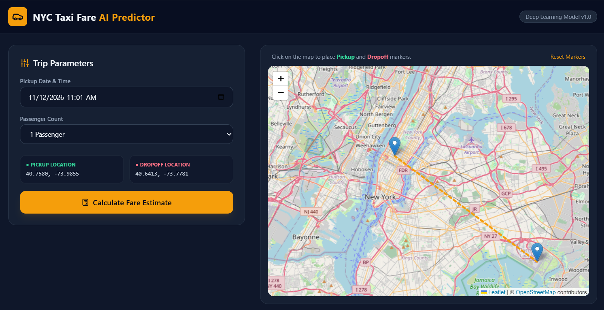
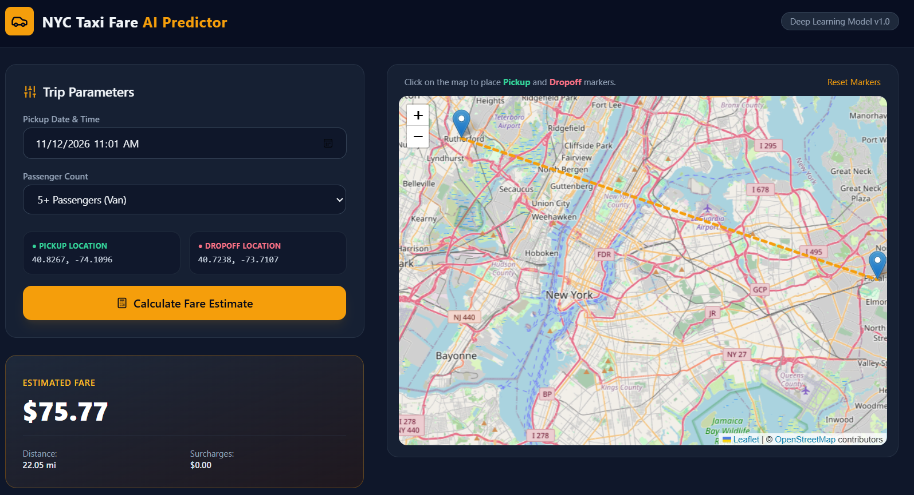

<div align="center">

# 🚕 NYC Taxi Fare AI Predictor

### End-to-End Deep Learning Regression & Interactive Geospatial Web Application

[](https://www.python.org/)
[](https://www.tensorflow.org/)
[](https://keras.io/)
[](https://flask.palletsprojects.com/)
[](https://leafletjs.com/)
[](https://tailwindcss.com/)
[](#license)

*An intelligent full-stack predictive analytics platform combining Deep Neural Networks, geodesic spatial feature engineering, and NYC Taxi & Limousine Commission (TLC) tariff modeling inside a real-time interactive map interface.*

[Project Overview](#project-overview) • [Dashboard Preview](#dashboard-preview) • [Core Capabilities](#core-capabilities) • [System Architecture](#system-architecture) • [ML Pipeline](#ml-pipeline) • [Tech Stack](#tech-stack) • [API Documentation](#api-documentation) • [Roadmap](#roadmap) • [Project Structure](#project-structure) • [Installation](#installation)

</div>

---

<a name="project-overview"></a>
## 📋 Project Overview

Estimating urban taxi fares accurately requires modeling complex non-linear interactions between **geospatial coordinates**, **temporal traffic patterns**, **regulatory surcharges**, and **airport flat-rate zones**. Simple straight-line distance approximations often fail to account for New York City's dynamic borough boundaries, rush-hour congestion tariffs, and major transit hubs.

**NYC Taxi Fare AI Predictor** solves this problem through a two-tier architecture:
1. **Offline Deep Learning Research Pipeline (`NYC_Taxi_Fare_Prediction.ipynb`):** Performs large-scale data ingestion, statistical anomaly pruning, spatial-temporal feature extraction, and supervised regression training using a multi-layer Keras Deep Neural Network (DNN).
2. **Real-Time Full-Stack Inference Engine (`app.py` & `templates/index.html`):** Exposes a low-latency Flask REST API paired with an interactive Leaflet.js map dashboard, enabling users to drop or drag pickup and drop-off pins across New York City and receive instant fare, distance, and surcharge breakdowns.

---

<a name="dashboard-preview"></a>
## 📸 Dashboard Preview

<div align="center">

### 🗺️ Interactive Geospatial Map & Trip Parameter Controls
*Users can click anywhere on the OpenStreetMap canvas or drag markers dynamically to set exact coordinates, passenger counts, and pickup timestamps.*



<br/><br/>

### 💵 Real-Time Fare Estimation & Surcharge Breakdown
*Instantaneous calculation displaying total estimated fare, geodesic trip distance in miles, and active NYC TLC peak/overnight surcharges.*



</div>

---

<a name="core-capabilities"></a>
## 🌟 Core Capabilities & Features

### 1. Interactive Geospatial Mapping (`Leaflet.js` + `OpenStreetMap`)
- **Dual-Mode Coordinate Selection:** Alternate-click directly on the map canvas to place **Pickup** and **Dropoff** markers, or click-and-drag existing pins for fine-grained street-level adjustments.
- **Live Vector Polyline Rendering:** Automatically draws and updates a dashed trajectory vector connecting origin and destination coordinates on every drag or click event.
- **One-Click State Reset:** Instantly restores default Manhattan (Times Square) to JFK Airport coordinates and recenters the viewport.

### 2. Geodesic Spatial Engineering Engine
- **Great-Circle Distance Computation:** Calculates exact spherical surface distance between pickup and drop-off latitude/longitude pairs in both kilometers and miles.
- **Airport Hub Geofencing:** Evaluates proximity against coordinates for **John F. Kennedy International Airport (JFK)**, **LaGuardia Airport (LGA)**, and **Newark Liberty International Airport (EWR)** to trigger flat-rate airport tariff logic when within a `2.0 km` radius.

### 3. Dynamic NYC TLC Tariff & Temporal Surcharge Logic
- **Weekday Rush-Hour Detection:** Parses ISO-8601 datetime strings to detect weekday peak congestion windows (`Monday–Friday, 4:00 PM – 8:00 PM`) and applies the standard `$2.50` peak surcharge.
- **Overnight Tariff Evaluation:** Identifies late-night and early-morning trips (`8:00 PM – 6:00 AM`) and factors in the `$1.00` overnight surcharge.
- **Base & Distance Metering:** Combines a `$3.00` initial flag-drop base fare with `$3.30/mile` metered progression and a `$2.50` minimum fare floor.

### 4. Reproducible Deep Learning Training Pipeline
- **Deterministic Execution:** Enforces global random seed `42` across `numpy`, `random`, and `tensorflow` for reproducible experiments.
- **Comprehensive Outlier Sanitization:** Eliminates negative/zero fares, unpopulated passenger entries, and corrupted GPS coordinates outside the NYC metropolitan bounding box.

---

<a name="system-architecture"></a>
## 🏗️ System Architecture & Data Flow

The application follows a decoupled **Client–Server–Inference** architecture designed for fast asynchronous JSON communication without page reloads:

```text
+-----------------------------------------------------------------------------------+
|                        CLIENT LAYER (Browser / Frontend)                          |
|                                                                                   |
|  +-------------------------------------+   +-----------------------------------+  |
|  |     Interactive Leaflet.js Map      |   |       Trip Configuration Form     |  |
|  |  • Draggable Pickup/Dropoff Pins    |   |  • ISO Datetime Picker            |  |
|  |  • Click-to-Place Event Listeners   |   |  • Passenger Count Selector (1-5) |  |
|  |  • Dynamic Geodesic Polyline        |   |  • Live Lat/Lon Coordinate Sync   |  |
|  +------------------+------------------+   +-----------------+-----------------+  |
|                     |                                        |                    |
|                     +-------------------+--------------------+                    |
|                                         |                                         |
|                            Async Fetch API (POST /predict)                        |
|                            Content-Type: application/json                         |
+-----------------------------------------|-----------------------------------------+
                                          |
                                          v
+-----------------------------------------------------------------------------------+
|                      APPLICATION LAYER (Flask Backend - app.py)                   |
|                                                                                   |
|  +-----------------------------------------------------------------------------+  |
|  |                        Request Validation & Parsing                         |  |
|  |  • Extracts float coordinates, integer passenger count, & datetime object   |  |
|  +--------------------------------------+--------------------------------------+  |
|                                         |                                         |
|                                         v                                         |
|  +--------------------------------------+--------------------------------------+  |
|  |                   Feature Engineering & Tariff Engine                       |  |
|  |  1. Haversine Formula -> Great-Circle Distance (km & miles)                 |  |
|  |  2. Airport Proximity -> Min distance to JFK (40.6413, -73.7781) & LGA      |  |
|  |  3. Temporal Parser   -> Weekday Peak (16:00-20:00) & Night (20:00-06:00)   |  |
|  +--------------------------------------+--------------------------------------+  |
|                                         |                                         |
|                                         v                                         |
|  +--------------------------------------+--------------------------------------+  |
|  |                     Prediction & Response Serializer                        |  |
|  |  • Computes final metered/flat-rate fare & returns structured JSON payload  |  |
|  +--------------------------------------+--------------------------------------+  |
+-----------------------------------------|-----------------------------------------+
                                          |
                              JSON Response (HTTP 200)
                                          |
                                          v
+-----------------------------------------------------------------------------------+

🧠 Machine Learning & Mathematical Pipeline1. Dataset Characteristics & Sanitization (NYC_Taxi_Fare_Prediction.ipynb)Dataset Source: Kaggle New York City Taxi Fare Prediction dataset (100,000 sampled records across 8 raw columns: key, fare_amount, pickup_datetime, pickup_longitude, pickup_latitude, dropoff_longitude, dropoff_latitude, passenger_count).Statistical Profile: Raw target fare_amount spans from -$44.90 to $200.00 (mean $11.35, std $9.72), necessitating strict domain-driven cleaning rules:Fare Validity Filter: fare_amount > $0NYC Metropolitan Bounding Box:$$\text{Latitude} \in [40.50^\circ, 40.90^\circ], \quad \text{Longitude} \in [-74.25^\circ, -73.70^\circ]$$Passenger Count Filter: passenger_count >= 12. Geodesic Distance Formulation (Haversine Equation)To compute accurate surface distance between two coordinates $(\phi_1, \lambda_1)$ and $(\phi_2, \lambda_2)$ on Earth ($R = 6371.0\text{ km}$):$$a = \sin^2\left(\frac{\Delta\phi}{2}\right) + \cos(\phi_1)\cos(\phi_2)\sin^2\left(\frac{\Delta\lambda}{2}\right)$$$$d_{\text{km}} = 2R \cdot \text{atan2}\left(\sqrt{a}, \sqrt{1 - a}\right), \quad d_{\text{miles}} = d_{\text{km}} \times 0.621371$$3. Deep Neural Network (DNN) ArchitectureThe regression model is implemented using the TensorFlow 2.20 / Keras Sequential API:Pipeline StageConfiguration & DetailsInput LayerNormalized spatial coordinates, engineered geodesic distances, passenger count, and cyclical/extracted temporal featuresHidden LayersMulti-layer Dense blocks with ReLU activations for non-linear spatial representationRegularization & StabilityBatchNormalization layers to stabilize internal covariate shift + Dropout layers to prevent overfitting on high-variance tripsOutput LayerSingle linear Dense(1) neuron outputting continuous fare_amountOptimizers EvaluatedAdam, RMSprop, and SGDTraining CallbacksEarlyStopping (monitors validation loss) & ReduceLROnPlateau (adaptive learning rate decay)Evaluation MetricsMean Absolute Error (MAE), Mean Squared Error (MSE), and Coefficient of Determination (R²)🛠️ Complete Technology StackCategoryTechnologyVersion / PurposeCore LanguagePython3.12 — Primary language for ML modeling and backend APIDeep LearningTensorFlow / Keras2.20.0 — Sequential DNN construction, training, and evaluationData ProcessingNumPy & Pandas1.26.4+ / 2.2.0+ — Vectorized math and tabular data manipulationML UtilitiesScikit-Learn & Joblib1.4.0+ / 1.3.2+ — Train/test splitting, scaling, and metric computationWeb FrameworkFlask3.0.2+ — Lightweight WSGI web server and RESTful routingMapping EngineLeaflet.js & OpenStreetMap1.9.4 — Interactive map rendering, markers, and vector polylinesUI Styling & IconsTailwind CSS & Lucide Icons3.4 (CDN) — Utility-first dark-mode glassmorphic UI components🔌 REST API DocumentationPredict Taxi Fare: POST /predictComputes estimated fare, geodesic distance, and applicable time-of-day surcharges from JSON trip parameters.Request HeadersHTTPContent-Type: application/json
Request Payload ExampleJSON{
  "pickup_latitude": 40.7580,
  "pickup_longitude": -73.9855,
  "dropoff_latitude": 40.6413,
  "dropoff_longitude": -73.7781,
  "passenger_count": 2,
  "pickup_datetime": "2026-11-12T17:30"
}
Parameter ReferenceFieldTypeRequiredDescriptionpickup_latitudefloatYesOrigin latitude in decimal degrees (e.g., 40.7580)pickup_longitudefloatYesOrigin longitude in decimal degrees (e.g., -73.9855)dropoff_latitudefloatYesDestination latitude in decimal degrees (e.g., 40.6413)dropoff_longitudefloatYesDestination longitude in decimal degrees (e.g., -73.7781)passenger_countintegerYesNumber of passengers (1 to 5+)pickup_datetimestringYesISO-8601 local timestamp formatted as YYYY-MM-DDTHH:MMSuccessful Response (200 OK)JSON{
  "status": "success",
  "predicted_fare": "$72.50",
  "distance_miles": "13.48 mi",
  "distance_km": "21.69 km",
  "pickup_time": "Thursday, Nov 12 2026 at 05:30 PM",
  "details": {
    "peak_surcharge": "$2.50",
    "night_surcharge": "$0.00",
    "passengers": 2
  }
}
Error Response (400 Bad Request)JSON{
  "status": "error",
  "message": "Invalid coordinate or datetime format provided."
}
🔮 Roadmap & Future Enhancements[ ] Direct .keras Model Serialization: Export the trained Keras DNN weights (model.keras) and fitted StandardScaler (scaler.pkl) from the notebook into app.py for hybrid DNN + tariff ensemble inference.[ ] Road-Network Routing Integration: Connect to the OSRM (Open Source Routing Machine) API to trace real Manhattan street grids and compute driving distance/duration instead of straight-line geodesic vectors.[ ] NYC Borough GeoJSON Overlays: Render interactive boundaries for Manhattan, Brooklyn, Queens, The Bronx, and Staten Island with historical fare density heatmaps.[ ] Containerized Cloud Deployment: Add a Dockerfile and gunicorn production WSGI configuration for deployment on Render, Railway, or AWS EC2.📂 Project StructurePlaintextnyc-taxi-fare-predictor/
│
├── assets/                                # Documentation visual assets
│   ├── dashboard-preview.png              # Full dark-mode dashboard & interactive map view
│   └── route-selection.png                # Live route selection & fare output card view
│
├── static/                                # Static frontend assets
│   ├── css/
│   │   └── style.css                      # Custom stylesheet overrides
│   └── js/
│       └── main.js                        # Modular client-side scripts
│
├── templates/                             # Jinja2 HTML templates
│   └── index.html                         # Complete interactive dashboard (Tailwind + Leaflet.js)
│
├── app.py                                 # Flask web server, Haversine engine & /predict REST API
├── NYC_Taxi_Fare_Prediction.ipynb         # Jupyter Notebook: EDA, cleaning & Keras DNN training
├── requirements.txt                       # Python package dependencies
├── .gitignore                             # Excludes __pycache__, venv, checkpoints & raw CSVs
└── README.md                              # Comprehensive project documentation
🚀 Installation & Local DeploymentPrerequisitesPython: Version 3.10, 3.11, or 3.12Package Manager: pip (latest version recommended)Browser: Any modern browser (Chrome, Edge, Firefox, Safari)Step-by-Step SetupClone the RepositoryBashgit clone [https://github.com/Anubhab47677/nyc-taxi-fare-predictor.git](https://github.com/Anubhab47677/nyc-taxi-fare-predictor.git)
cd nyc-taxi-fare-predictor
Create and Activate a Virtual Environment (Recommended)Bash# Create virtual environment
python -m venv venv

# Activate on Windows (PowerShell)
.\venv\Scripts\Activate.ps1

# Activate on macOS / Linux
source venv/bin/activate
Install DependenciesBashpip install -r requirements.txt
Launch the Flask ServerBashpython app.py
You should see output confirming the server is active on port 5000:Plaintext* Running on [http://127.0.0.1:5000](http://127.0.0.1:5000)
Access the Web Application
Open your browser and navigate to http://127.0.0.1:5000.📄 LicenseThis project is open-source and available under the MIT License.Developed by AnubhabIf you found this project useful, please consider giving it a ⭐ on GitHub!
|                     UI PRESENTATION LAYER (Tailwind CSS Card)                     |
|  • Updates Predicted Fare ($), Trip Distance (mi), and Surcharge Breakdown ($)    |
+-----------------------------------------------------------------------------------+
